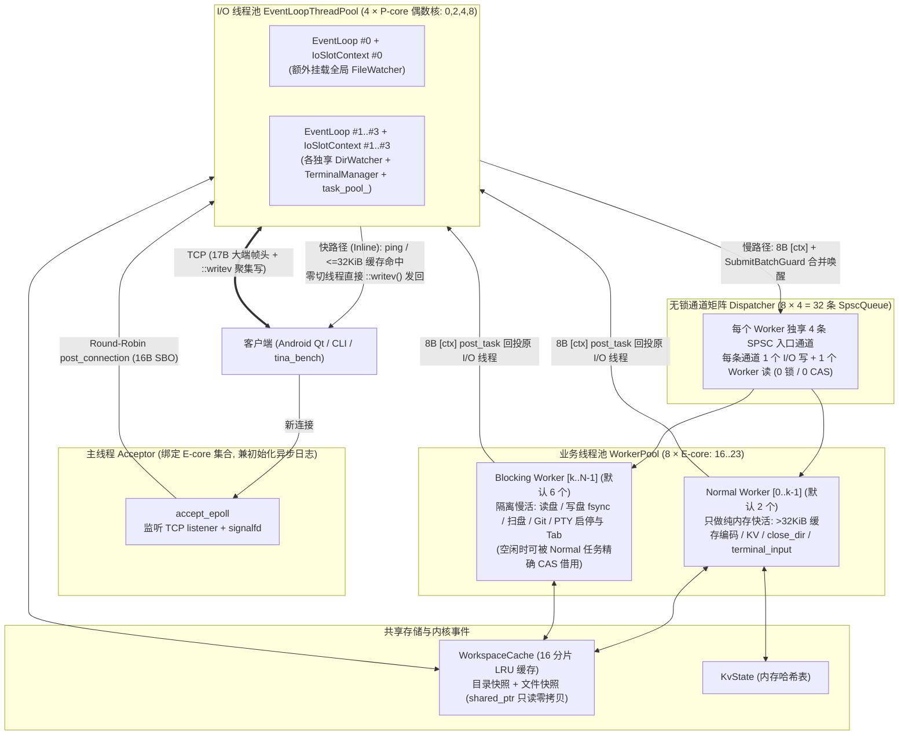

# Tina 项目深度指南：架构全景、运作流程与性能优化原理

> 这是一份**按执行逻辑串联**的工程说明书。本文不堆砌干瘪的 API 列表，而是沿着「系统启动 -> 连接接入 -> 请求流转 -> 业务处理 -> 响应回写 -> 优雅停机」的完整主线，讲透 Tina 是怎么跑起来的、每个模块里的核心状态到底解决什么问题，以及每一处底层性能优化（64B 缓存行布局、无锁队列、错峰步长、24B SBO、零拷贝 `writev` 等）背后的第一性原理。

---

## 一、Tina 是什么？要解决什么核心矛盾？

**Tina** 是一个运行在 Linux 上、基于 **C++23 Named Modules（`.cppm` + `import std;`）** 编写的高性能 RPC 与远程开发（Remote IDE）后端服务，向上承接桌面/Android Qt 客户端（`android_app/`）与压测程序（`tina_bench`），提供 5 组业务能力：

1. **System（`0x00xx`）**：连通性探测（`ping`）。
2. **KV（`0x01xx`）**：内存键值存取删。
3. **Workspace（`0x02xx`）**：项目列表、单层目录懒加载、分段文件读取、乐观锁原子保存、目录关闭与基于 `inotify` 的实时变更推送。
4. **Terminal（`0x03xx`）**：基于 Linux 伪终端（PTY）的交互式 Bash 会话、实时输出推送、命令完成感知与 Readline Tab 补全。
5. **Git（`0x04xx`）**：仓库状态、工作区/分支 Diff 与提交历史（最多 100 条）。

### 它面对的核心性能矛盾

Remote IDE 的流量特征极其分裂：
- **极快的热请求**：`ping`、高频点击展开目录、读取热点源码文件——这些请求本应是**微秒级纯内存操作**，追求极致 QPS 与极低尾延迟（P99）。
- **极慢的阻塞重活**：冷文件读盘、写文件加 `fsync`、执行 `git diff`/`git log` 子进程、启动 Bash 伪终端或等待 Tab 补全——动辄耗时**几毫秒到上百毫秒**。

如果把这两类请求丢进同一个传统互斥锁线程池，几个并发 `git` 或磁盘写入就会把所有线程堵死在内核 `poll()` / `fsync()` 上，造成严重的**队头阻塞（Head-of-Line Blocking）**；反过来，如果每条热请求都要经历“I/O 线程 -> 加锁入队 -> 切线程唤醒 Worker -> 加锁回投 -> `eventfd` 唤醒 I/O 线程”，跨线程与内存分配开销又会把吞吐量打骨折。

### Tina 的破局方案（全景架构）



一句话总结 Tina 的架构哲学：**物理核按快慢隔离、请求按实际路径三级分流、跨线程只传单指针零堆分配、数据全链路零拷贝**。

---

## 二、系统启动流程：从 `main()` 到开始接客

打开 [src/main.cppm](file:///home/rance/projects/tina/src/main.cppm) 和 [src/rpc/server.cppm](file:///home/rance/projects/tina/src/rpc/server.cppm)，服务启动并不是简单地 `listen()` 然后起几个线程，而是严格按照**依赖与硬件隔离顺序**推进 5 个步骤：

### 第 1 步：解析与校验配置（`main.cppm` -> `runtime/config.cppm`）
`parse_server_args()` 用无区域依赖的 `std::from_chars` 严格解析命令行参数（拒绝负数回绕和 `"2abc"` 类杂字符），填充 `runtime::ServerConfig` 并立即调用 `validate()`：
- **`io_cpus`（默认 `{0, 2, 4, 8}`）**：4 个 I/O 线程绑定的逻辑核。之所以专挑**偶数核**，是因为在 i9-14900HX 上 `{0,1}`、`{2,3}` 等互为同一颗 P-core 的超线程兄弟（SMT siblings）；只绑偶数核并配合下线奇数核，可以让每个 EventLoop 独享整颗 P-core 的 L1/L2 与执行单元。
- **`worker_cpus`（默认 `{16..23}`）**：8 个 Worker 绑定的独立 E-core 物理核（E-core 无超线程，1 核 1 线程）。
- **`non_blk_worker_cnt`（默认 `2`）**：把 Worker 划分为 `[0, 2)` 两个 Normal Worker 和 `[2, 8)` 六个 Blocking Worker（经实测穷举 $k=1..7$ 选出的最优配比）。
- **`queue_cap`（默认 `128`）**：每条 SPSC 通道的槽位数，强制为 `>= 2` 且是 2 的幂（用 `std::has_single_bit` 校验），用于把环形队列取模优化为位与 `& mask_`。
- **`io_inline_threshold`（默认 `32 KiB`）**：I/O 线程直接内联响应缓存命中的最大载荷字节数。超过此值的缓存命中会交给 Normal Worker 处理，防止大包编码阻塞同一 EventLoop 上的其他连接。

### 第 2 步：在任何子线程出生前屏蔽退出信号（`StopSignals`）
`rpc::run_server()` 进入后做的**第一件事**就是构造 `StopSignals`：
1. 调用 `::pthread_sigmask(SIG_BLOCK, &mask_, ...)` 阻塞 `SIGINT` 和 `SIGTERM`。
2. 创建非阻塞 `::signalfd(-1, &mask_, SFD_NONBLOCK | SFD_CLOEXEC)`。

**为什么要这么早？** 因为 Linux 的信号阻塞掩码由子线程继承。必须赶在 `spdlog` 异步日志线程、`EventLoopThreadPool` 和 `WorkerPool` 创建之前屏蔽这两个信号，才能确保进程收到 `Ctrl+C` 或 `SIGTERM` 时不会被异步信号处理函数随机打断任意线程，而是稳定转成一条可读事件送进 Acceptor 的 `epoll_wait`，像处理普通网络事件一样同步触发优雅停机。

### 第 3 步：硬件拓扑校验、主线程绑核与异步日志初始化（`cpu_affinity.cppm`、`log.cppm`）
若开启 `enable_cpu_affinity`：
1. `validate_topology()` 读取 `/sys/devices/system/cpu/online`、`sched_getaffinity()`（受 `taskset`/cgroup 限制）以及每个配置核的 `thread_siblings_list`：
   - 核不在线、不在进程可用集合内、或任意两个配置核落在同一物理核的一对超线程上 -> **直接报错拒绝启动**；
   - 若 P-core I/O 核的超线程兄弟仍在线 -> 记录告警，提醒压测前隔离。
2. 先调用 `pin_thread_to_cpus(config.worker_cpus)` 把 **Acceptor 主线程**绑到 E-core 集合 `{16..23}`，**然后**再调用 `runtime::log::init()` 启动 `spdlog` 异步日志（8192 队列 + 1 个后台写线程，双路输出彩色控制台 + 10 MiB×3 轮转文件）。
   - **巧妙之处**：后台日志线程自动继承主线程的 E-core 亲和性，磁盘刷日志的抖动绝不会干扰跑在 P-core 上的 I/O 线程。

### 第 4 步：启动双线程池并预绑核（`event_loop_thread_pool.cppm`、`worker_pool.cppm`）
1. **建立监听 Socket**：`Socket::listen_tcp(port)` 优先尝试双栈 IPv6（显式设置 `IPV6_V6ONLY = 0`，单监听 fd 同时接 IPv6 与 IPv4 映射连接），失败回退 IPv4，设为非阻塞后与 `signalfd` 一起加入 `accept_epoll`。
2. **启动 `EventLoopThreadPool` 和 `WorkerPool`**：
   - 两者采用同一套安全启动范式：每个线程在 `pthread_create` 之前先通过 `ScopedThreadAttr` 调用 `pthread_attr_setaffinity_np` **预绑核**（让线程从第一条指令就落在目标核心上，避免启动跨核迁移污染 L1/L2）；线程入口执行 `pin_thread_to_cpu()` 二次设置并用 `pthread_getaffinity_np` + `CPU_EQUAL` 回读验证；主线程通过栈上 `std::latch` 等待全部线程就绪，任何单线程启动/绑核失败都会立刻 `shutdown()` 回收所有已起线程后再重抛异常。

### 第 5 步：装配每 I/O 线程的 `IoSlotContext` 与启动监听器
`create_io_slots()` 为每个 I/O 线程在堆上分配一个地址永不移动、64B 对齐的 `IoSlotContext`（`std::unique_ptr` 托管）：
- 填满 **Cache Line 0 只读区**（指向 `EventLoop`、`WorkerPool`、`ConnectionCounter`、`KvState`、`DirWatcher`、`TerminalManager` 的裸指针 + `IoDispatchView`）；
- 创建本 I/O 线程私有的 `DirWatcher` 和 `TerminalManager`；
- 调用 `prewarm_task_pool()` 提前预热 **64 个** `RpcTaskContext`（容器预先 `reserve(1024)`）；
- 通过 `run_on_all_slots()` 同步向各 I/O 线程投递启动任务，让每个 `EventLoop` 在**自己的线程里**创建 `DirWatcher` 的 `inotify_fd` 并挂进自己的 `epoll`；0 号 I/O 线程额外启动进程级全局 `FileWatcher`。

至此，服务端打印配置日志，Acceptor 进入 `run_accept_loop()` 正式对外服务。

---

## 三、核心运作流程：一条连接与一帧请求的完整一生

下面我们跟踪一条客户端 TCP 连接从连上到断开、以及一帧 RPC 请求如何穿越全部模块并回到客户端。

### 阶段 1：建连与无锁交接（Acceptor -> 目标 I/O 线程）
1. 客户端三次握手完成，`accept_epoll.wait()` 唤醒 Acceptor。
2. Acceptor 在单轮内循环调用 `listener.try_accept()` **最多 64 次**（避免突发连接风暴饿死退出信号检测）：
   - 底层用 `::accept4(..., SOCK_NONBLOCK | SOCK_CLOEXEC)` 一次系统调用同时设好非阻塞与 CLOEXEC；
   - 立即对新连接开启 `TCP_NODELAY` 关闭 Nagle 算法；
   - 遇到 `ECONNABORTED` / `EPROTO`（客户端握手刚完就发 RST）直接忽略重试，不搞垮服务端。
3. Acceptor 按普通 Round-Robin 选出目标 `IoSlotContext`（`slots[next_io]`），调用 `detail::post_connection(std::move(*client), slot)`：
   - 构造仅捕获 `[socket, &slot]` 的 **16 字节闭包**（命中 `EventLoop::Task` 24B SBO，零堆分配），投递进目标 `EventLoop::post_task()`。
4. 目标 `EventLoop` 的 `eventfd` 被唤醒，在自己线程内执行 `register_connection()`：
   - 调用 `slot.allocate_conn_id()` 递增本线程私有的非原子 `next_conn_id_`，生成一个永不重复的 **64 位连接世代号 `conn_id`**；
   - 构造 `std::shared_ptr<Connection>` 存入 `slot.connections[fd]`；
   - 注册 epoll 事件掩码 `EPOLLONESHOT | EPOLLIN | EPOLLRDHUP`（回调仅捕获 `[conn, &slot]`，正好 **24 字节**命中 SBO），并将全局 `ConnectionCounter` 加 1。

> **为什么要挂 `EPOLLONESHOT`？**
> 每次事件触发后内核自动屏蔽该 fd，直到本轮处理完毕调用 `refresh_connection()` 重新武装，彻底杜绝多线程误重入；同时平时**不监听 `EPOLLOUT`**，避免发送缓冲空闲时 epoll 疯狂空转。

### 阶段 2：收包、拆帧与三级分流（I/O 线程热路径）
当客户端发来请求字节流，目标 `EventLoop` 回调 `handle_connection_event()`：

1. **开启批量唤醒作用域**：构造 `WorkerPool::SubmitBatchGuard wake_batch(*slot.workers, io_id)`。这保证本轮 `recv` 拆出的几十条慢请求不会每条都触发内存栅栏和 `futex` 唤醒，而是等到本轮读完统一做一次合并唤醒。
2. **直写收包（最多 8 轮防饿死）**：进入 `Connection::read()`：
   - 每轮确保 `input_`（`net::Buffer`）尾部至少有 8 KiB 可写空间，直接把 `input_.writable_data()` 交给 `::recv()`，读到 `*n` 字节后 `input_.commit_write(*n)`，**全程没有中间栈缓冲 `memcpy`**。
   - 若 `*n == 0`（对端半关闭 `FIN`），置 `peer_eof_ = true`：如果此时 `input_` 里还残留拆不完整的半帧，判定协议错误返回 `false` 断连；否则允许已有在途请求继续算完发回。
3. **17 字节大端序拆帧（`decode_frame`）**：
   ```text
    0       4     5              13       15       17
   +-------+-----+--------------+--------+--------+-------------------+
   |Length |Kind |  Request ID  | Method | Status |     Payload...    |
   | (4B)  |(1B) |     (8B)     |  (2B)  |  (2B)  | (Length - 13 B)   |
   +-------+-----+--------------+--------+--------+-------------------+
   ```
   - 先看缓冲区是否有 4 字节，用 `read_be<uint32_t>` 读出 `Length`（含后 13B 帧头 + Payload），校验 `13 <= Length <= 1 MiB`（防止恶意包诱发超大分配）；
   - 数据不够 `4 + Length` 时直接返回 `nullopt`（半包留在 `input_` 等待下次 `EPOLLIN`）；
   - 校验头部合法性（如 `request` 的 `request_id != 0` 且 `status == ok`），拷贝出 `frame.payload` 并 `input_.retrieve(4 + length)` 推进读游标。
4. **三级分流决策（`try_inline_or_classify`）**：
   每拆出一帧完整 `request`，立刻按**实际执行成本**分流成三条路径：

   - **路径 A：Inline 内联快路径（留在当前 I/O 线程，0 线程切换）**
     - **`system_ping`**：最先判断，连 `PreparedDispatch` 都不碰，原地把 `payload` 改成 `"PONG"` 直接返回 `true`。
     - **`workspace_read_file` 小文件/小切片缓存命中**：`probe_cached_read_file()` 零拷贝解码路径、查 `WorkspaceCache`；若命中且切片 `<= io_inline_threshold`（默认 32 KiB），原地把 16B 元数据头（`file_size` + `revision`）写进 `frame.payload`，把只读缓存快照 `shared_ptr<const ReadFileResponse>` 挂到 `frame.payload_owner`，切片视图挂到 `frame.external_payload`，**零字节拷贝正文**返回 `true`。
     - **`workspace_list_dir` 小目录缓存命中**：`probe_cached_list_dir()` 查目录缓存、单遍估算编码大小；若 `<= 32 KiB` 原地编码入 `frame.payload` 并把目录路径填入 `inline_watched_dir` 返回 `true`。
     - 凡返回 `true` 的请求：`Connection::read()` 立即调用 `enqueue_direct_response()` 压入发送队列（不递增 `pending_`，积压超过 256 KiB 时顺手先 `writev` 刷一次防撑爆 4 MiB 背压上限），若是目录命中则在 `on_inline_enqueued` 回调中直接向本线程 `DirWatcher` 注册 `inotify`。

   - **路径 B：Normal Worker 异步路径（纯内存/轻量操作，绝不碰磁盘）**
     - `read_file` / `list_dir` 命中缓存但体积 `> 32 KiB`：把**已经查到的只读 `shared_ptr` 快照**连同切片偏移塞进 `PreparedDispatch` 带给 Normal Worker。这有两个巨大好处：① Normal Worker 不用二次加缓存锁；② 即使在排队期间该条目被 LRU 淘汰了，快照依然存活，Normal Worker **绝对不会被迫降级去读磁盘**！
     - `kv_set/get/del`、`workspace_close_dir`、`terminal_input`（只是把命令投递给 I/O 线程的 `write_buffer` 就立刻回 OK，不等待命令跑完），以及参数非法或不支持的方法（快回错，不占 Blocking 核）。

   - **路径 C：Blocking Worker 异步路径（重磁盘 / 阻塞系统调用）**
     - `read_file` / `list_dir` 缓存未命中、`workspace_list_projects`、`workspace_write_file`（含 `fsync` + `rename`）、`git_status/diff/log`（`fork` + `poll`）、`terminal_state`（`forkpty` / `waitpid`）、`terminal_on_tab`（`poll` 等 Readline 补全）。

### 阶段 3：无锁装盒、调度分派与 Worker 消费
当一条请求落入路径 B 或路径 C，且当前连接在途请求数 `pending_ < 64` 时，进入 `submit_to_worker()`：

1. **无锁借池节点**：`slot.acquire_task_ctx()` 从本 I/O 线程私有的 `task_pool_` 栈顶 O(1) 弹出一个热 `RpcTaskContext`（256B），把 `request`、`prepared`、`conn_fd`、`conn_id` 移入其中，递增 `conn->pending_`。
2. **8B 闭包提交**：构造仅捕获 `[ctx]` 的 `worker_lambda`（8B <= 24B SBO），调用 `slot.workers->try_submit(io_id, task_class, std::move(worker_lambda))`。
3. **`Dispatcher::try_submit()` 选人 -> 占坑 -> 入队**：
   - **选人**：
     - Blocking 任务只在 Blocking 区 `[k, N)` 中从本 I/O 线程私有的 `idx_blocking` 起转一圈，挑 `outstanding` 最轻者（遇 `0` 立即早退），选中后把 `idx_blocking` 推到下一位打散热点；
     - Normal 任务先在 Normal 区 `[0, k)` 挑最轻者；若其完全空闲（`count == 0`）直接用；若 Normal 全忙，扫描 Blocking 区寻找精确满足 `state == kIdleBit` 的空闲大军标记 `borrow = true`；都忙则退回最轻 Normal Worker。
   - **占坑（Reservation）**：
     - 借用路径：精确 `compare_exchange_strong(kIdleBit, 1, seq_cst, relaxed)`，多个 I/O 线程同时抢同一个空闲 Blocking Worker 至多 1 人赢；
     - 普通路径：直接一条 wait-free `state.fetch_add(1, seq_cst)`！即使此时 `state` 挂着 `kIdleBit`，加 1 后变成 `kIdleBit | count`，立刻自动令其他人的借用 CAS 失败，彻底消除普通提交的 CAS 自旋。
   - **停机复查 + 无锁入队**：`seq_cst` 复查 `stopping` 标志（与 Worker 退出检查构成全序防丢单），随后写入 `slot.lanes[io_id]->try_push(std::move(task))`；若该 lane 满则回滚 `state` 并标记排除位改试下一个候选 Worker。
   - **记录唤醒位图**：入队成功后因为正处于 `SubmitBatchGuard` 作用域内，只需执行一条纯寄存器指令 `io.waiting_wake_mask |= (1ULL << worker_id)`。
4. **批尾合并唤醒**：当 `Connection::read()` 退出、`wake_batch` 析构触发 `flush_submit_batch()`：
   - 若有新提交任务，整批只执行 **1 次** `atomic_thread_fence(seq_cst)`，用 `std::countr_zero` 遍历位图，仅对挂有 `kSleepingBit` 的真正睡眠 Worker 通过 CAS 递增纪元并调用 `wake_epoch.notify_one()`。正在干活的 Worker **0 原子写、0 futex**。
5. **Worker 取活与执行**：
   - 每个 Worker 在 `worker_loop()` 中按私有游标 `lane_cursor` 公平轮询自己的 $I$ 条 SPSC lane（防某条高负载 I/O 通道饿死其他通道）；
   - 取到任务后进入 `execute_task()`：稳态时 `kIdleBit` 已为 0 零开销跳过，刚从空闲切入工作态时才 `fetch_and(kCountMask)` 清位；用局部 `CountGuard` 先构造、`local_task` 后构造，保证即使抛异常也**先析构闭包释放捕获对象，再 `state.fetch_sub(1, acq_rel)` 归还计数**；
   - 当所有 lane 全空时，先查停机退出条件；未停机且 `state == 0` 时通过 `CAS(0, kIdleBit)` 挂出空闲牌子允许被借用；随后对 `wake_epoch` 置位 `kSleepingBit` -> 立下 `seq_cst` 栅栏 -> **二次扫描所有 lane** -> 仍空则进入 `wake_epoch.wait()` 深度休眠。

### 阶段 4：Worker 执行业务与原地回投
`handle_request(RpcTaskContext *ctx)` 在 Worker 线程中执行：
1. 原地把 `ctx->frame.kind` 从 `request` 改为 `response`（复用原 `request_id` 与 `method`）。
2. 若 `prepared.cached_file` 或 `prepared.cached_dir` 非空，直接调用 `finish_cached_read_file` / `finish_cached_list_dir` 消费快照并清空释放引用；否则进入 `dispatch_request()` 按 `method_group(request.method)`（高 8 位位与）跳转到 KV / Workspace / Terminal / Git 对应业务处理器。
3. 捕获所有异常（`std::bad_alloc` -> `resource_exhausted`，其余 -> `internal`），构造 8B `[ctx]` 闭包调用 `slot.loop->post_task()` 把结果送回**原连接的 I/O 线程**。

### 阶段 5：I/O 线程验活、聚集写回与池节点归还
原 I/O 线程在 `complete_response(RpcTaskContext *ctx)` 中收尾：
1. 入口立即建 `RecycleGuard`：无论连接是否已断、发包成功还是抛异常，函数返回时必调用 `slot.release_task_ctx(ctx)` 无锁归还节点到 `slot.task_pool_`。
2. **世代号验活**：在本线程 `slot.connections` 查找 `conn_fd` 并核对 `conn->id() == ctx->conn_id`。如果客户端早已断开、甚至同一个 fd 已被新连接复用，`conn_id` 不匹配，直接安全丢弃响应，零原子操作彻底消灭 UAF 与 ABA。
3. **目录监听同步**：若是成功的 `workspace_list_dir` / `workspace_close_dir`，同步在本线程无锁 `DirWatcher` 中执行 `watch()` / `unwatch()`。
4. **零拷贝入队与 `::writev()` 聚集写**：调用 `conn->enqueue_response(response)`（`--pending_`，把 17B 帧头写进 `Item::header`，直接 `std::move` 接管 `payload` 与 `payload_owner`），随后立即尝试 `conn->write()`：
   - `FrameSendQueue::write()` 遍历队头待发帧，把每帧的「17B 帧头 + 内联 payload + 外置只读切片」三段中未发完的部分依次挂进栈上 `struct iovec[64]` 数组，一次 `::writev()` 写入内核；
   - 若实际写出字节数 `*n < batch_bytes`（内核发送缓冲区已满），立即 `break` 退出循环，留待下次 `EPOLLOUT` 续发。
5. **按需更新 epoll**：记录入队前的 `had_write`，只有当 `conn->finished()`（该关连接了）或 `conn->wants_write() != had_write`（待写状态从空变非空、或从非空变空）时，才调用 `refresh_connection()` 执行 `epoll_ctl`。稳态下一次 `writev` 当场写空，**省去整次 `epoll_ctl` 系统调用**。

### 阶段 6：半关闭排空与五阶段优雅停机
- **单连接半关闭**：对端发 `FIN`（`peer_eof_ = true`）后，若还有在途 Worker 任务（`pending_ > 0`）或未发完数据（`!output_.empty()`），连接不会立刻销毁，而是摘除可读监听、静默等所有在途响应发空使 `finished() == true`，再由 `close_slot_connection()` 同步清理关联 PTY 并从 `epoll` 和 `connections` 摘除。
- **整服五阶段停机（`shutdown_server`）**：收到 `SIGINT`/`SIGTERM` 后，依次执行 **① 停监听 -> ② 冻结所有 I/O 线程（停 DirWatcher/FileWatcher/TerminalManager 并对全部连接 `begin_shutdown()`）-> ③ `workers.shutdown()` 排空并 join 全部 Worker -> ④ `ConnectionCounter::wait_empty_for(5s)` 等剩余响应发空（超时则强关残留连接）-> ⑤ `io_pool.shutdown()` 回收所有 I/O 线程**，最后 `main()` 刷盘异步日志。

---

## 四、四大业务子系统运作详解

### 4.1 Workspace 文件、目录、16 分片缓存与双 Watcher 一致性闭环

Workspace 是 Remote IDE 最核心、也最复杂的子系统，围绕**“读要快（尽量零磁盘、零拷贝），写要稳（不丢数据、不覆盖他人、缓存绝不脏）”**设计了一整套状态机：

1. **路径防逃逸与两级校验（`service/file.cppm`）**
   所有客户端路径均为相对于 `~/projects` 的相对路径。热路径缓存命中时只调零堆分配的 `is_valid_workspace_rel_path()`（禁止 `/` 首尾、空段 `//`、`.`、`..`、`\0`）与 `has_projects_root_env()`；只有真要碰文件系统时才 `resolve_workspace_path()` 拼接绝对路径。

2. **16 分片 LRU 缓存与 `epoch` 乐观防脏回填（`service/workspace_cache*.cppm`）**
   - `WorkspaceCache` 内部包含两套 `ShardedLruCache`：目录缓存 `dirs_`（默认 4096 项 / 32 MiB，不建父索引）与文件缓存 `files_`（默认 8192 项 / 128 MiB，单文件上限 2 MiB，编译期开启父目录倒排索引 `dir_index` 以便关闭目录时 O(k) 淘汰该目录下所有子文件）。
   - **如何防止“并发读盘把旧数据写回缓存覆盖掉刚刚的新修改”？**
     每个分片维护单调递增版本号 `epoch`。任何失效（`invalidate*`/`clear`）或 `write_file` 写穿都会递增 `epoch`。后台 Blocking Worker 读盘/扫盘**之前**先记下 `epoch`；读完盘回填 `put_dir`/`put_file` 时比对 `shard.epoch == expected_epoch`——只要中途发生过修改或 `inotify` 失效，`epoch` 已变，直接放弃本次回填，**完全不需要在慢速磁盘 I/O 期间持有缓存锁**。

3. **读文件全流程（`ide/server_file_read.cppm`）**
   - I/O 线程命中 `<= 32 KiB` 直接内联零拷贝发走；命中 `> 32 KiB` 由 Normal Worker 组装 16B 头 + 外置切片发走。
   - 缓存未命中进入 Blocking Worker：打开文件后进入最多 **16 次**的乐观读循环（防止外部高频写导致活锁）：
     1. 读前 `fstat` 计算 64 位 FNV-1a 版本指纹 `file_revision`（混合 `dev/ino/size/mtim/ctim`，避免结构 padding 差异）；
     2. 若文件 `<= 2 MiB`（可缓存）：先向 `FileWatcher` 注册该文件监听并采样 `epoch`，整文件 `pread` 读入；
     3. 若文件 `> 2 MiB`（超大文件不进缓存）：在 `std::string` 头部预留 16 字节，直接 `pread_range_at(..., /*out_offset=*/16)` 把目标区间从内核读入 `content.data() + 16`；
     4. 读后再次 `fstat` 比对指纹：一致说明读盘期间无并发撕裂——可缓存文件写入 `WorkspaceCache` 并零拷贝切片返回，超大文件直接在头部 0..15B `write_be` 回填 `file_size`/`revision` 后把整串 `std::move` 给 `frame.payload`。

4. **原子写文件全流程（`ide/server_file_write.cppm`）**
   - 先零拷贝解码 `WriteFileRequestView`（参数非法、版本冲突或超大文件均**不拷贝最高 1 MiB 正文**）；
   - 获取 64 路缓存行对齐路径锁 `path_mutex_for(*full_path)`（同文件严格串行，不同文件并行）；
   - `lstat` 校验当前指纹是否等于客户端 `expected_revision`，不等则立刻返回 `Status::conflict` + 最新指纹（供客户端拉取合并）；
   - 在**同一目录**创建 `mkostemp(".tmp.XXXXXX")` 并由 `TempFileGuard` 兜底自动 `unlink`，复制原文件权限位、`write_all` + `fsync` 落盘，再 `lstat` 二次校验原文件未被外部篡改；
   - 注销旧 inode 的 `FileWatcher` 监听并失效旧缓存 -> `::rename()` 原子替换（同挂载点原子切 inode，断电也不会出现写了一半的残缺文件）-> 对新 inode 重新注册监听并写穿刷新缓存 `put_file_after_write()`。

5. **为什么拆成 `DirWatcher` 和 `FileWatcher` 两套监听器？**
   - **`DirWatcher`（每 I/O 线程独享，完全无锁）**：只关心**“客户端当前展开着的目录”**里文件的增删改名（`IN_CREATE | IN_DELETE | IN_MOVED_FROM | IN_MOVED_TO | IN_DELETE_SELF | IN_MOVE_SELF`），需要向订阅连接推送 `workspace_list_dir` Event 帧。
     - **原子写降噪**：识别 `.tmp.` 文件及其 `IN_MOVED_FROM` / `IN_MOVED_TO` 的配对 `cookie`，把 `workspace_write_file` 原子替换产生的伪目录变更事件直接滤掉；
     - **突发合并重扫**：单轮 `on_event` 按 `wd` 去重（同目录只失效一次缓存）；若该目录正在后台扫盘（`refreshing == true`），新来的变更只把 `dirty = true`，等当前扫描回来推送完后再补扫一次；
     - **零拷贝多播**：若一个目录有多个订阅连接，循环前调用一次 `event_frame->share_payload()` 提升为共享切片，各连接只增一次引用计数。
   - **`FileWatcher`（进程级全局，挂在 0 号 I/O 线程）**：只关心**“当前躺在 `WorkspaceCache` 里的缓存文件”**的内容/属性变更（`IN_MODIFY | IN_CLOSE_WRITE | IN_ATTRIB | IN_DELETE_SELF | IN_MOVE_SELF`）。即使文件所在目录从未被客户端 `list_dir` 展开，缓存文件也能独立获得实时失效保护；同时通过 `WorkspaceCache::set_file_evict_callback()` 在文件被 LRU 淘汰时自动 `inotify_rm_watch` 回收内核 watch 槽位（且严格在释放缓存分片锁后回调，杜绝 AB-BA 死锁）。

---

### 4.2 Terminal 伪终端（PTY）全双工与 Tab 补全原理

服务端每个 I/O 线程持有一个 `TerminalManager`（`ide/server_terminal*.cppm` + `service/terminal*.cppm`），管理本线程名下连接的全部 Bash 会话：

1. **启动 Bash 与零盲等错误探测（`spawn_bash_pty`）**
   - 在 `forkpty()` **之前**先在父线程算好工作目录 `cwd`（避免多线程进程在 `fork` 后的子进程里分配堆内存或调 `getenv`），并创建一条带 `O_CLOEXEC` 的错误通知管道 `err_pipe`。
   - 子进程关闭 `ECHOCTL`（防止 Ctrl+U 回显 `^U`）、设 `PS1=""` 清空提示符，并注入最关键的环境变量：
     ```bash
     PROMPT_COMMAND="bind 'set enable-bracketed-paste off' >/dev/null 2>&1; printf '\033]777;__TINA_DONE__\007'"
     ```
     每当 Bash 跑完一条命令、准备重新等输入时，就会自动吐出这段不可见的私有 OSC 结束标记。
   - 若 `execvp("bash")` 成功，内核自动关闭 `err_pipe[1]`，父进程读到 EOF 立刻知道启动成功；若失败，子进程把 `errno` 写进管道，父进程马上报错并 `EINTR`-safe `waitpid` 回收。随后排空首条启动标记，再通过 `promise/future` 同步把非阻塞 `master_fd` 挂载到所属连接的 `EventLoop` 监听 `EPOLLIN`。

2. **零拷贝命令下发与非阻塞流式输出**
   - **`terminal_input`（走 Normal Worker）**：原地往请求帧 `frame.payload` 末尾 `push_back('\r')`，整块 `std::move` 投递给所属 I/O 线程；I/O 线程单线程无锁把跳过 8B 头部的命令字节追加到 `session->write_buffer`，临时开启 `EPOLLOUT`；`on_pty_event` 写完立即撤销 `EPOLLOUT`。
   - **实时输出与跨包剥离标记**：`on_pty_event` 单次最多读 8×8 KiB（栈缓冲不零初始化，避免每次 `memset` 8 KiB），追加到 `read_carry`。`process_pty_output()` 循环扫描 `prompt_done_marker`：
     - 标记之前的普通字节按 64 KiB 分块推送 `terminal_output (0x0381)` Event；
     - 遇到完整标记则剥离它，并通过 `running_command.exchange(false)` 推送 `terminal_state (0x0303)` Event 通知客户端命令执行完毕；
     - **半包边界保护**：若末尾有 1~20 字节恰好是 `prompt_done_marker` 的前缀，`safe_output_prefix_len()` 会把这部分暂留在 `read_carry` 等下一块拼齐后再判，绝不把半截控制序列漏发给客户端。

3. **Tab 补全与单行 ANSI 光标模拟器（`terminal_completion.cppm`）**
   - 收到 `terminal_on_tab`（走 Blocking Worker）时，加 `session->tab_mutex` 并置 `tab_completing = true` 暂时让 I/O 线程不要抢读 `master_fd`；
   - 向 PTY 发送 `\x05\x15`（Ctrl+E + Ctrl+U 清行）-> 写入用户输入 + `\t` -> 首次 `poll(60ms)` 随后 `15ms` 短窗收齐 Bash Readline 回显 -> 再次 `\x05\x15` 清行防污染后续命令；
   - 由于 Readline 回显混杂了 `\r`、`\b`、响铃 `\a`、CSI（`\x1b[K` 清至行尾、`\x1b[nC`/`\x1b[nD` 移动光标）和 OSC 序列，`parse_pty_tab_completion()` 用一个轻量**单行光标模拟器**逐字节重放这些终端动作，还原出屏幕上最终显示的纯净补全命令。

---

### 4.3 Git 子进程安全执行与零中间拷贝直编

所有 Git RPC（`ide/server_git.cppm` + `service/git*.cppm`）运行在 Blocking Worker 上：

1. **双管道防死锁与直接写入 `net::Buffer`（`run_git_command`）**
   - 同时创建 `stdout` 和 `stderr` 两条非阻塞管道，在父进程中通过 `::poll()` 同时监听两路读端（受 10 秒超时与 1 MiB 单帧上限双保护，超限直接 `SIGKILL` 并安全 `waitpid` 回收）。为什么必须双管道 `poll`？Linux 管道缓冲约 64 KiB，如果子进程写满 `stderr` 而父进程阻塞在读 `stdout`，双方就会死锁。
   - `drain_pipe` 直接向 `GitExecResult::out_buf`/`err_buf`（`net::Buffer`）尾部可写区 `::read()`，零中间栈拷贝。
2. **安全防注入与零分配参数构造**
   - `resolve_git_repo_path()` 复用工作区路径防逃逸检查；`valid_git_ref()` 严禁分支名以 `'-'` 开头或含 `..`/`@{`/控制字符，防止 `--output=...` 参数注入。
   - `git status` 和 `git log` 直接把编译期 `static constexpr std::array<const char*, N>` 传给 `execvp`，零堆分配；
   - **`git diff` 原地补 `\0` 技巧**：对比两个不同分支时，请求格式是 `[u16 path_len][path][u16 base_len][base][target]`。服务端利用 `base_branch` 前面那 2 字节已经读完的 `base_len`，把 `base_branch` 在 `frame.payload` 原地左移 1 字节并在尾部写 `'\0'`，而 `target_branch` 位于 `std::string` 末尾天然带 `'\0'`——不分配一个字节堆内存就造出两个合法 C 字符串直传 `execvp`！
3. **单遍流式直编（`service/git_protocol.cppm`）**
   - `encode_status_porcelain_z_into` 和 `encode_log_z_into` 直接在 `res.stdout_view()`（指向 `net::Buffer`）上按 `\0` 和 `\x1f` 切片并写入 `frame.payload`，**完全不构造中间 `vector<GitStatusEntry>` 或 `vector<GitCommit>`**；写 `git log` 的父提交列表时，先在 `out` 中 `push_back('\0')` 占 1 字节 `parent_count` 槽位，逐个写完父哈希后再按偏移原地回填计数。

---

### 4.4 内存 KV、异步 RPC 客户端与独立 C++ IDE SDK

- **`KvService`（`service/kv.cppm`）**：由 `KvState::mutex` 串行化保护，采用透明哈希 `TransparentHash` + `std::equal_to<>`，`kv_set` 原地更新、`kv_get`/`kv_del` 查询均不额外构造临时键 `std::string`。
- **`RpcClient`（`rpc/client*.cppm`）**：启动 1 条专属 `EventLoop` 线程单线程管理 `RpcClient::State`（无锁操作 `pendings` 哈希表与有序集合 `deadlines`）。最多 64 个并发在途请求共享 **1 个 `CLOCK_MONOTONIC` `timerfd`**，仅当最早截止时间 `deadlines.begin()` 变化时才调 `timerfd_settime()`；已超时请求的 ID 记入 `expired_ids`（上限 1024），后续收到迟到响应静默丢弃而不破坏整条连接。
- **独立 C++ 客户端 SDK（`ide/client_*.cppm`）与预留协议（`file/protocol.cppm`、`net/address.cppm`）**：封装了客户端懒加载文件树（`apply_list_dir` 增量刷新复用已展开子树）、`TerminalClient` 以及零拷贝 `string_view` Git DAG 泳道布局算法（`build_git_graph` 预先 `resize` 固定节点字符串地址，让活跃泳道表全程零拷贝）。当前服务端运行不依赖这些客户端 SDK（Android/桌面端采用 Qt 实现同一套线上协议），保留供学习参考与 C++ 侧测试/扩展。

---

## 五、性能优化专题深潜（按模块拆解痛点、原理与细节）

这一章专门沉淀项目里最硬核的底层优化，每一项都讲清 **「不优化会怎样 -> 我们怎么改的 -> 精确到字节/缓存行/指令级的收益」**。

### 5.1 缓存行布局与伪共享消除（Cache-Line Layout）

x86-64 的 L1d 缓存行固定为 **64 字节**（`kCacheLineBytes = 64`）。若核心 A 写变量 `X`、核心 B 写变量 `Y`，只要 `X` 和 `Y` 落在同一条 64B 缓存行，MESI 协议就会在两核之间疯狂来回抢占所有权（Invalidation Storm），吞吐瞬间腰斩。Tina 在 5 处核心数据结构上做了精确的 64B 布局：

#### 1. `SpscQueue<T>`：三缓存行隔离 + 单槽位 64B 对齐（`runtime/spsc_queue.cppm`）
```text
+-------------------------------------------------------------------+
| CL0 (只读元数据, 构造后永不写 -> 双核 L1d 长期 MESI Shared)         |
|   capacity_ (8B) | mask_ (8B) | slots_ (8B) | padding (40B)       |
+-------------------------------------------------------------------+
| CL1 (生产者 I/O 核独占写热点)                                      |
|   atomic<uint64_t> tail_ (8B) | uint64_t cached_head_ (8B) | pad  |
+-------------------------------------------------------------------+
| CL2 (消费者 Worker 核独占写热点)                                   |
|   atomic<uint64_t> head_ (8B) | uint64_t cached_tail_ (8B) | pad  |
+-------------------------------------------------------------------+
| slots_ 堆数组: struct alignas(64) Slot { std::optional<T> item; } |
|   128 槽 × 64B = 8 KiB/条，32 条矩阵总计 256 KiB -> 整片驻留 L2/L3 |
+-------------------------------------------------------------------+
```
- **为什么每个 `Slot` 也要 `alignas(64)`？** 队列几乎为空或只有 1~2 个元素时，生产者写的 `slots_[t]` 和消费者正在读的 `slots_[t-1]` 是紧挨着的。如果不按 64B 对齐，相邻槽位会挤进同一缓存行，低队列深度延迟反而最差。

#### 2. `WorkerControl` 与 `IoDispatchContext`（`runtime/dispatcher.cppm`）
- 每个 `WorkerControl` 将 `state`（高频占坑/扣减）、`wake_epoch`（仅休眠/唤醒触碰）和 `lanes`（只读指针数组）各自 `alignas(64)` 独占一条缓存行，确保稳态工作时读写 `state` 不会污染 `wake_epoch` 和 `lanes`。
- 每个 I/O 线程的 `IoDispatchContext` 独立 `alignas(64)`，不同 I/O 线程更新自己的轮询游标和唤醒位图零互相干扰。

#### 3. `IoSlotContext`：严丝合缝的 64B 冷热读写分离（`rpc/connection_context.cppm`）
```text
Cache Line 0 (offset 0..63B, 启动后全程只读 -> P-core 与 E-core 长期共享 'S' 态):
  [0..7]   EventLoop*         loop          (8B)
  [8..15]  WorkerPool*        workers       (8B)
  [16..23] ConnectionCounter* counter       (8B)
  [24..31] KvState*           kv            (8B)
  [32..39] DirWatcher*        watcher       (8B)
  [40..47] TerminalManager*   terminal_mgr  (8B)
  [48..63] IoDispatchView     io_view       (16B: io_id + inline_threshold)
  -------------------------------------------------------------- 精确 64 Bytes!

Cache Line 1+ (alignas(64), offset 64B.., 仅所属 I/O 线程单线程高频写入):
  connections | task_pool_ | next_conn_id_ | watcher_owner | terminal_mgr_owner
```
- **双重收益**：① I/O 线程高频借还 `task_pool_`、增删 `connections` 只改 CL1+，**绝不弄脏 Worker 正在读的 CL0**；② 用 CL0 裸指针取代原先每条请求拷贝 3 个 `shared_ptr`（`kv`/`watcher`/`terminal_mgr`），**每条慢请求立省 6 次原子引用计数加减**。

#### 4. `RpcTaskContext`：256B（4 条缓存行）按跨核访问时序排布（`rpc/connection_context.cppm`）
通过 `static_assert(sizeof(RpcTaskContext) == 4 * 64)` 锁死大小：
```text
CL0 (0..63B)   : slot*(8B) + conn_fd(4B+4B pad) + conn_id(8B) + Frame 前 40B (完整帧头 + payload 头)
CL1 (64..127B) : Frame 剩余 48B + watched_dir 前 16B
CL2 (128..191B): watched_dir 剩余 16B + PreparedDispatch 前 48B
CL3 (192..255B): PreparedDispatch 剩余 40B + 24B 尾部填充
```
- 无论 Worker 刚拿到 `ctx` 还是 I/O 线程收到回传，解引用 **CL0** 一次缓存行拉取就能拿到槽位指针、连接世代号和完整 RPC 帧头；
- 尾部的 `prepared` 在 Worker 入口消费完立即清空，I/O 线程回写与归还池节点时**完全不碰 CL3**，省去整行跨核缓存同步。

#### 5. 缓存分片与路径写锁防伪共享
- `ShardedLruCache::Shard`（16 分片）和 `service::file::path_mutex_for`（64 路路径锁）均加 `alignas(64)`，防止不同文件/缓存分片的 `std::mutex` 落在同一缓存行。

---

### 5.2 无锁并发、错峰步长（Stride）与批量合并唤醒

#### 1. `SpscQueue` 双端本地缓存游标（Cached Index）
- **痛点**：普通无锁 SPSC 每次 `try_push` 都要 `acquire` 读取消费者修改的 `head_`，每次 `try_pop` 都要 `acquire` 读取生产者修改的 `tail_`，导致两条核心之间频繁跨核拉取对方缓存行。
- **做法**：生产者在自己的缓存行里存一份非原子 `cached_head_`。平时只用 `relaxed` 读自己的 `tail_`，拿 `(t - cached_head_) >= capacity_` 判断是否看似已满——未满直接写入，**完全不碰消费者缓存行**；只有本地视角看似满了，才 `acquire` 刷新一次真正的 `head_`。消费者对称维护 `cached_tail_`。
- **收益**：稳态下每 `128` 次入队/出队才跨核读一次对方游标，全路径 **0 次 CAS / RMW**；64 位无符号减法天然免疫 `UINT64_MAX` 回绕。

#### 2. `Dispatcher` 错峰步长（Staggered Stride）与热点打散
- **痛点**：如果 4 个 I/O 线程都从 Worker 0（和 Blocking Worker $k$）开始扫描选人，冷启动或所有 Worker 负载打平时，4 个 P-core 会同时选中同一个 Worker，一起 `fetch_add` 打爆它的 `state` 缓存行并挤占同一条队列。
- **做法**：
  1. **初始错峰步长**：构造 `Dispatcher` 时给第 `io` 号 I/O 线程错开起点：`idx_normal = io % normal_count`，`idx_blocking = normal_count + io % blocking_count`。
  2. **命中后游标前推**：`select_lightest_in_range()` 从 `rr_cursor` 顺时针扫一圈（`relaxed` 读 `state`，遇到 `count == 0` 立即 `break` 早退），选中 `best->worker_id` 后立刻把 `rr_cursor` 推进到下一位 `next_in_range(best->worker_id, begin, end)`，用一次比较替代 `%` 除法。
- **收益**：彻底打散热点，均匀分散多核原子写争用。

#### 3. 状态字位布局：普通提交 0 CAS + 精确 CAS 主动借用
`WorkerControl::state`（64 位原子整数）把 `Bit 63` 定为 `kIdleBit`、`Bits 0..62` 定为 `outstanding`：
- **普通提交**：直接单条 wait-free `fetch_add(1, seq_cst)`。哪怕此时 Worker 刚挂了 `kIdleBit`，加 1 后 `state` 变成 `kIdleBit | 1`，不再等于纯 `kIdleBit`，瞬间自动屏蔽所有借用者，彻底省去 CAS 重试循环；
- **空闲借用**：Normal 全忙时扫描 Blocking 区，只对精确等于 `kIdleBit` 的 Worker 做一次 `CAS(kIdleBit, 1)`，保证至多 1 个 I/O 线程成功借走它，防止多条 Normal 任务同时灌进同一个 Blocking Worker；
- **惰性清位**：Worker 执行任务前先 `relaxed` 检查 Bit 63，稳态下位已是 0 直接跳过（0 额外原子写）。

#### 4. `SubmitBatchGuard` + `wake_epoch`（步长 `kEpochStep = 2`）+ Dekker 零丢唤醒
- **痛点**：每提交 1 条任务就做一次 `seq_cst` 栅栏 + 查睡眠状态/调 `notify_one()`，在流水线突发下栅栏与 `futex` 开销巨大；但如果不加栅栏直接看睡眠位，x86 的 Store-Load 重排会导致“生产者以为 Worker 没睡、Worker 二次扫描又没看到新任务”的永久死睡（Lost Wakeup）。
- **做法**：
  - `wake_epoch` 用 `Bit 0` 表示 `kSleepingBit`，`Bits 1..63` 表示唤醒纪元（每次唤醒加 `kEpochStep = 2` 并清除 `Bit 0`）；
  - 单轮 epoll 拆包（或 `inotify` 批处理）包在 `SubmitBatchGuard` 内，期间每次入队只在线程私有 `uint64_t waiting_wake_mask` 里置 1 个 bit；
  - 批尾 `flush_submit_batch()` 整批只立 **1 次** `atomic_thread_fence(seq_cst)`，用硬件指令 `std::countr_zero` (`tzcnt`) 遍历置位 Worker，先 `relaxed` 查 `kSleepingBit`——**没睡直接跳过（0 原子写、0 futex）**；真睡了才 CAS 清位加 2 并由唯一赢家调 `notify_one()`；
  - 对称地，Worker 睡前 `fetch_or(kSleepingBit)` -> `fence(seq_cst)` -> 二次扫全部 lane -> `wake_epoch.wait(parked_epoch)`，与生产者形成严格 **Dekker 全序**，数学上杜绝丢唤醒。

---

### 5.3 内存分配治理：24B SBO、无锁对象池与连接世代号

- **24B SBO 红线**：libstdc++ 的 `std::move_only_function` 内置小对象缓冲只有 **24 字节**（对齐 <= 8B）。如果跨线程回调直接捕获 `Frame`(88B) + `PreparedDispatch`(88B) + 多个 `shared_ptr`，每次任务往返就要 `new/delete` 两次。
  - Tina 把全部在途字段收敛进 `RpcTaskContext`（`DirWatcher` 同理有 `RefreshTaskContext`），让 `worker_lambda`、`complete_lambda` 都缩小成 **8 字节 `[ctx]`**，`register_lambda` 为 **16 字节 `[socket, &slot]`**，epoll 回调为 **24 字节 `[conn, &slot]`**，并全部用 `static_assert(sizeof(...) <= 24)` 在编译期守死。
- **单线程无锁对象池**：`RpcTaskContext` 始终在同一个 I/O 线程借出、经 Worker 处理后必回同一 I/O 线程归还，因此 `slot.task_pool_`（预热 64、上限 1024）操作完全 **0 锁、0 原子指令**；归还时保留 `<= 16 KiB` payload 和 `<= 1 KiB` path 的堆容量复用，超过水位则主动释放防内存膨胀。
- **连接世代号 `(conn_fd, conn_id)` 替代 `weak_ptr<Connection>`**：彻底消灭每条慢请求 4 次控制块原子加减，同时在单 I/O 线程内 O(1) 查表验活并防 fd 复用 ABA。

---

### 5.4 网络 I/O、零拷贝与系统调用削减

1. **三段零拷贝 `Frame` + `FrameSendQueue::write` (`::writev()`)**
   - 入队不拼接连续大缓冲、不 `memcpy` 正文，只把 17B 帧头写进内联数组，直接 `std::move` 接管 `payload` 和 `payload_owner`；
   - 发送时一次 `::writev()` 最多聚集 **64 段 `iovec`** 跨越多个待发帧写入内核；遇到短写（`*n < batch_bytes`）立即 `break` 退出，省掉一次必触发 `EAGAIN` 的无效系统调用。
2. **输入直写与懒紧缩（`net::Buffer`）**
   - 服务端 `Connection::read`、客户端 `State::receive`、Git 管道 `drain_pipe` 全都直接向 `Buffer::writable_data()` 读取并 `commit_write`，零临时栈拷贝；
   - 全部消费完仅归零游标保容量；部分消费达到 `read_index_ >= 4096 && read_index_ >= write_index_ / 2` 才 `memmove`（但 `ensure_writable` 若发现前端+尾部总空闲已足够，会优先原地紧缩避免无谓 2× 扩容）。
3. **`EventLoop` 唤醒与分发四大削减**
   - **唤醒合并**：`post_task` 仅在队列由空转非空时写 `eventfd`；
   - **单次归零**：非信号量 `eventfd` 一次成功 `::read()` 即原子清零计数器，直接返回（省去每次唤醒多一次 `EAGAIN` 读）；
   - **零堆分配换桶**：`tasks_` 和 `pending_tasks_` 改为 `std::vector` 成员，每次唤醒 `swap` 后执行并 `clear()` 保留容量；
   - **消除每事件 `shared_ptr` 原子计数**：回调表改用 `unique_ptr<Handler>`，仅当回调执行期（`dispatching_ == true`）调用 `del_event()` 自注销时把旧回调移进 `deferred_deletes_` 延迟到回调返回后销毁。
4. **按需 `epoll_ctl`、关 Nagle 与公平预算**
   - 服务端回写与终端推流记录 `had_write`，客户端缓存 `last_interest`，关注掩码不变绝不调 `epoll_ctl`；
   - 客户端/服务端统一开启 `TCP_NODELAY`，用户态靠 `FrameSendQueue` 合批、内核不再傻等 40 ms Delayed ACK；
   - `recv` 单次最多 8 轮、PTY `read` 最多 8 轮、`accept4` 最多 64 次，防止单条高活跃连接饿死同线程其他 fd；
   - 客户端 `handle_responses()` 整批拆包共享一次 `Clock::now()` 并在循环结束后最多调一次 `timerfd_settime()`。

---

### 5.5 缓存数据结构与 CPU 微架构优化

- **16 分片透明哈希 + 非拥有 `string_view` 索引**：`ShardedLruCache` 用 `hash & 15` 分片，`TransparentStringHash` 实现 `string_view` 零分配查找；`LruList`、`dir_index` 以及 `FileWatcher::wd_to_path_` 全部存储指向节点稳定 `std::string` 键的 `string_view`，消除双份路径内存拷贝；`[[no_unique_address]]` 让目录缓存的空父索引占用 0 字节；`has_evict_cb_` 放松原子标记让未注册回调时完全跳过分配淘汰列表。
- **单指令大端序编解码**：`read_be`/`write_be`/`append_be` 采用 `std::memcpy` + `std::byteswap`，无循环移位与对齐 UB。
- **L1 指令缓存（L1i）卫生**：现代核 L1i 仅 32~64 KiB。C++23 Named Modules 无需为了 ODR 给普通函数加 `inline`，本项目严格只对 1~3 行极短热访问器保留 `inline`，含循环/系统调用/状态机的函数均非内联，防止热路径指令膨胀引发 I-Cache Miss。

---

## 六、源码目录快速导航（全部 54 个文件）

按层次列出每个文件在全局架构中的角色与核心状态归属，方便改代码或深入学习时快速定位：

### 1. `src/runtime/`（基础设施与调度引擎 — 6 文件）
- [config.cppm](file:///home/rance/projects/tina/src/runtime/config.cppm)：定义并校验 `ServerConfig`（I/O 核、Worker 核、Normal 数量、队列容量、内联阈值、绑核开关）。
- [log.cppm](file:///home/rance/projects/tina/src/runtime/log.cppm)：异步 `spdlog` 封装（8192 队列 + 1 后台线程 + 控制台与 10 MiB×3 轮转文件）。
- [cpu_affinity.cppm](file:///home/rance/projects/tina/src/runtime/cpu_affinity.cppm)：Linux sysfs 拓扑解析、SMT 冲突校验、启动前预绑核 `ScopedThreadAttr` 与运行期绑核回读校验。
- [spsc_queue.cppm](file:///home/rance/projects/tina/src/runtime/spsc_queue.cppm)：三缓存行隔离 + 64B 槽位对齐 + 双端本地缓存游标的零 CAS 无锁环形队列 `SpscQueue<T>`。
- [dispatcher.cppm](file:///home/rance/projects/tina/src/runtime/dispatcher.cppm)：持有 $W \times I$ 队列矩阵与每 I/O 错峰游标，实现无 CAS 占坑、精确 CAS 主动借用与批量合并唤醒。
- [worker_pool.cppm](file:///home/rance/projects/tina/src/runtime/worker_pool.cppm)：持有 $N$ 个 Worker 线程与停机标志，实现公平轮询 lane、RAII 计数回收、Dekker 休眠协议与优雅排空（对外提供 `SubmitBatchGuard`）。

### 2. `src/net/`（网络原语与 Reactor — 8 文件）
- [buffer/storage.cppm](file:///home/rance/projects/tina/src/net/buffer/storage.cppm)：连续线性字节缓冲 `net::Buffer`（直写 `recv`、全空游标复位、4 KiB 惰性紧缩）。
- [buffer/frame_send_queue.cppm](file:///home/rance/projects/tina/src/net/buffer/frame_send_queue.cppm)：三段零拷贝帧发送队列 `FrameSendQueue`（最多 64 段 `iovec` 一次 `::writev()` 写出）。
- [buffer.cppm](file:///home/rance/projects/tina/src/net/buffer.cppm)：聚合导出 `storage` 与 `frame_send_queue`。
- [socket.cppm](file:///home/rance/projects/tina/src/net/socket.cppm)：RAII TCP `Socket`（双栈监听、非阻塞 connect/accept4/recv/writev、`TCP_NODELAY`、一次性忽略 `SIGPIPE`）。
- [epoll.cppm](file:///home/rance/projects/tina/src/net/epoll.cppm)：RAII `Epoll` 与 `EpollInterest`/`EpollEvent`（向上彻底隐藏 `<sys/epoll.h>`）。
- [event_loop.cppm](file:///home/rance/projects/tina/src/net/event_loop.cppm)：单线程 Reactor `EventLoop`（`epoll` + `eventfd` 合并唤醒 + `vector::swap` 复用 + `deferred_deletes_` 延迟自注销）。
- [event_loop_thread_pool.cppm](file:///home/rance/projects/tina/src/net/event_loop_thread_pool.cppm)：管理 $M$ 个可选绑核的 `EventLoop` 线程。
- [address.cppm](file:///home/rance/projects/tina/src/net/address.cppm)：预留空占位模块。

### 3. `src/rpc/`（RPC 帧、连接与调度闭环 — 10 文件）
- [payload.cppm](file:///home/rance/projects/tina/src/rpc/payload.cppm)：`std::byteswap` 大端序编解码器与零拷贝 `PayloadReader`。
- [protocol.cppm](file:///home/rance/projects/tina/src/rpc/protocol.cppm)：17B 固定帧头、位域 `Method`/`Status`、三段零拷贝 `Frame` 与头编解码。
- [task_classifier.cppm](file:///home/rance/projects/tina/src/rpc/task_classifier.cppm)：I/O 线程三级分流器 `try_inline_or_classify()` 与缓存快照载体 `PreparedDispatch`。
- [connection.cppm](file:///home/rance/projects/tina/src/rpc/connection.cppm)：服务端单连接状态机 `Connection`（8 轮 recv 预算、64 在途上限、4 MiB 背压、半关闭排空）与 `ConnectionCounter`。
- [connection_context.cppm](file:///home/rance/projects/tina/src/rpc/connection_context.cppm)：64B 读写隔离的 `IoSlotContext`、256B 池化 `RpcTaskContext`、统一断连清理 `close_slot_connection` 与 Watcher/Terminal 工厂。
- [connection_handler.cppm](file:///home/rance/projects/tina/src/rpc/connection_handler.cppm)：连接接入 -> epoll 读写分流 -> 8B SBO 投递 Worker -> 业务路由 -> 回写与池节点归还的完整主线。
- [server.cppm](file:///home/rance/projects/tina/src/rpc/server.cppm)：服务端总控 `rpc::run_server()`（`StopSignals`、核绑定、槽位装配、Acceptor 主循环与五阶段优雅停机）。
- [client_types.cppm](file:///home/rance/projects/tina/src/rpc/client_types.cppm) / [client_io.cppm](file:///home/rance/projects/tina/src/rpc/client_io.cppm) / [client.cppm](file:///home/rance/projects/tina/src/rpc/client.cppm)：异步 `RpcClient` 公开外观与单 I/O 线程状态机（共享 `timerfd`、缓存 `last_interest`、直写收包与迟到包清理）。

### 4. `src/service/` 与 `src/file/`（核心引擎与系统调用封装 — 13 文件）
- [service/kv.cppm](file:///home/rance/projects/tina/src/service/kv.cppm)：透明哈希内存 KV 服务。
- [service/file.cppm](file:///home/rance/projects/tina/src/service/file.cppm)：64 位 FNV-1a 文件指纹、`ScopedFd`/`ScopedDir`、`errno` 映射、工作区路径校验与 64 路 `alignas(64)` 路径写锁。
- [service/workspace_cache_lru.cppm](file:///home/rance/projects/tina/src/service/workspace_cache_lru.cppm) / [service/workspace_cache.cppm](file:///home/rance/projects/tina/src/service/workspace_cache.cppm)：16 分片 64B 对齐 `ShardedLruCache`（带 `epoch` 防脏回填与条件父目录索引）及 `WorkspaceCache` 全局门面。
- [service/file_watcher.cppm](file:///home/rance/projects/tina/src/service/file_watcher.cppm)：全局缓存文件 `inotify` 监听器（与 LRU 淘汰联动、非拥有 `wd_to_path_` 视图、同批事件去重）。
- [service/dir_watcher_types.cppm](file:///home/rance/projects/tina/src/service/dir_watcher_types.cppm) / [service/dir_watcher.cppm](file:///home/rance/projects/tina/src/service/dir_watcher.cppm)：每 I/O 线程独享无锁目录监听器（`.tmp.` 降噪、`refreshing`/`dirty` 合并重扫、8B SBO `RefreshTaskContext` 对象池与共享负载多播）。
- [service/git.cppm](file:///home/rance/projects/tina/src/service/git.cppm) / [service/git_process.cppm](file:///home/rance/projects/tina/src/service/git_process.cppm) / [service/git_protocol.cppm](file:///home/rance/projects/tina/src/service/git_protocol.cppm)：仓库路径/分支安全校验、双管道 `poll()` 直读执行器与 `-z` 单遍零中间拷贝直编器。
- [service/terminal.cppm](file:///home/rance/projects/tina/src/service/terminal.cppm) / [service/terminal_completion.cppm](file:///home/rance/projects/tina/src/service/terminal_completion.cppm)：`forkpty` Bash 启动与回收、`PROMPT_COMMAND` 标记切分、Tab 补全交互与单行 ANSI 光标模拟器。
- [file/protocol.cppm](file:///home/rance/projects/tina/src/file/protocol.cppm)：预留的分块文件上传/范围下载协议（复用 `rpc.payload`）。

### 5. `src/ide/` 与 `src/main.cppm`（IDE 协议、业务处理、C++ 客户端 SDK 与主入口 — 17 文件）
- [ide/protocol.cppm](file:///home/rance/projects/tina/src/ide/protocol.cppm) / [ide/server_protocol.cppm](file:///home/rance/projects/tina/src/ide/server_protocol.cppm) / [ide/client_protocol.cppm](file:///home/rance/projects/tina/src/ide/client_protocol.cppm)：IDE 公共协议数据结构与两端编解码（服务端全面零拷贝视图解码 + 原地复用 `Frame::payload` 编码）。
- [ide/server_file.cppm](file:///home/rance/projects/tina/src/ide/server_file.cppm) / [ide/server_directory.cppm](file:///home/rance/projects/tina/src/ide/server_directory.cppm) / [ide/server_file_read.cppm](file:///home/rance/projects/tina/src/ide/server_file_read.cppm) / [ide/server_file_write.cppm](file:///home/rance/projects/tina/src/ide/server_file_write.cppm)：Workspace 请求分发、3 级缓存探测、目录列举/关闭、乐观指纹读盘、超大文件 16B 预留直读与临时文件原子写穿。
- [ide/server_git.cppm](file:///home/rance/projects/tina/src/ide/server_git.cppm)：Git 三项业务处理器（静态 `argv`、原地补 `\0` `git diff` 与 `-z` 直编）。
- [ide/server_terminal_types.cppm](file:///home/rance/projects/tina/src/ide/server_terminal_types.cppm) / [ide/server_terminal_io.cppm](file:///home/rance/projects/tina/src/ide/server_terminal_io.cppm) / [ide/server_terminal_session.cppm](file:///home/rance/projects/tina/src/ide/server_terminal_session.cppm) / [ide/server_terminal.cppm](file:///home/rance/projects/tina/src/ide/server_terminal.cppm)：每 I/O 线程 `TerminalManager` 的会话启停、PTY `epoll` 读写回调与 RPC 请求入口。
- [ide/client_file_tree.cppm](file:///home/rance/projects/tina/src/ide/client_file_tree.cppm) / [ide/client_file.cppm](file:///home/rance/projects/tina/src/ide/client_file.cppm) / [ide/client_terminal.cppm](file:///home/rance/projects/tina/src/ide/client_terminal.cppm) / [ide/client_git.cppm](file:///home/rance/projects/tina/src/ide/client_git.cppm)：独立 C++ 客户端 SDK（懒加载文件树、终端客户端与 Git DAG 泳道布局算法）。
- [main.cppm](file:///home/rance/projects/tina/src/main.cppm)：CLI 总入口（`server` / `ping` / `set` / `get` / `del` / `async-test`）。

---

## 七、构建、测试与下一步进阶探索

### 常用命令
```bash
# 1. 配置与编译（Clang + Ninja + C++23 Modules）
cmake --preset default && cmake --build build

# 2. 运行全部 8 项单元测试、集成测试与混合压测
ctest --test-dir build --output-on-failure

# 3. 以默认 4P+8E 拓扑启动服务端（容器或非混合核机器可加 --no-affinity）
./tina server 3490 --normal-workers 2 --queue-capacity 128 --inline-threshold 32768 \
    --io-cpus 0,2,4,8 --worker-cpus 16-23
```

### 后续值得深入的学习与优化课题
1. **真正异步的 Git 子进程（`pidfd_open` + `EventLoop`）**：目前 `run_git_command` 虽已隔离在 Blocking Worker 且双管道防死锁，但仍会在 `::poll()` 上挂起该 Worker；未来可把管道与 `pidfd` 交给 I/O 线程 `epoll` 托管，实现零阻塞等待。
2. **极热点读缓存去互斥锁（`shared_mutex` + Touch Stride / CLOCK）**：目前 `ShardedLruCache::get()` 每次读命中都要加分片互斥锁并 `splice` 链表；若未来出现极高并发单热点文件争用，可升级为 `std::shared_mutex` 读锁配合 **Touch Stride**（每命中 $N$ 次才提升一次，或用原子访问位做 CLOCK 近似淘汰）。
3. **分片锁 `KvService` 与 `::sendfile()` 大文件直传**：KV 从单锁升级为 16/64 分片 `shared_mutex`；超过 2 MiB 的超大文件发完 33B 帧头+元数据头后用 `::sendfile()` 从内核页缓存直发网卡。
4. **`inotify` `timerfd` 防抖窗口**：面对 `cmake --build` 等瞬时爆发海量文件事件的场景，可按目录增加 10~30 ms 轻量防抖延迟再触发重扫。
